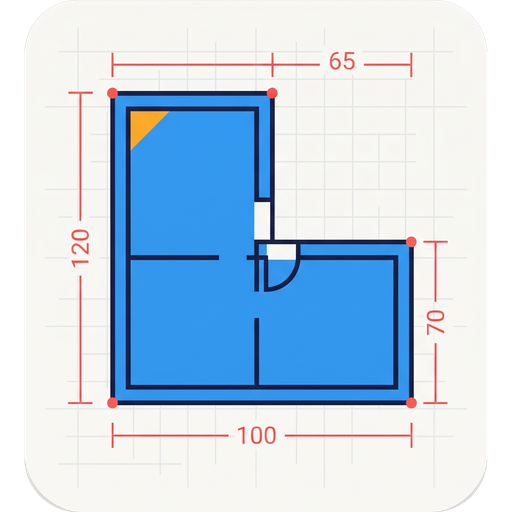
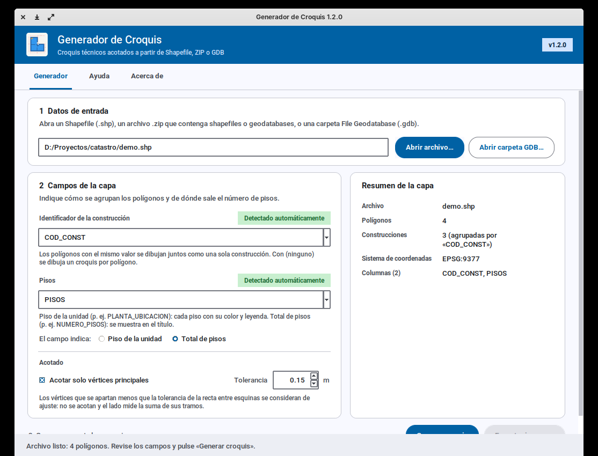
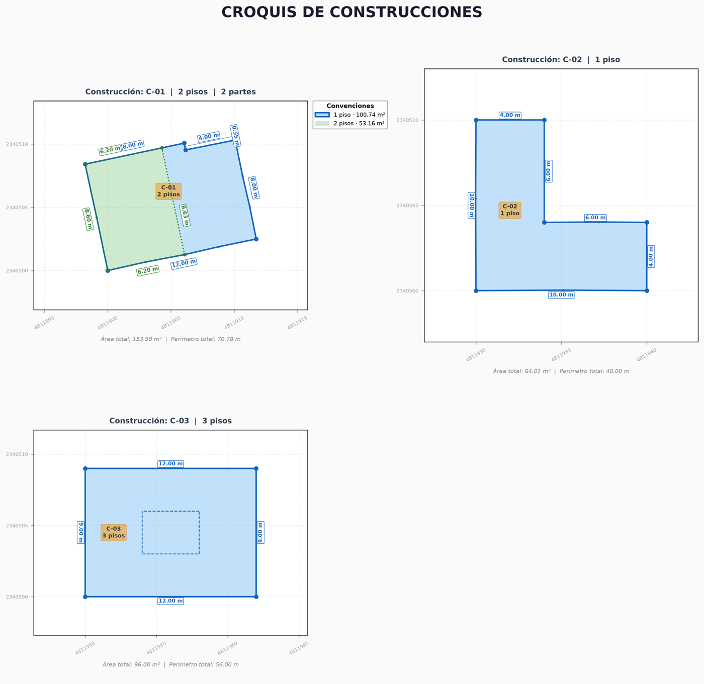
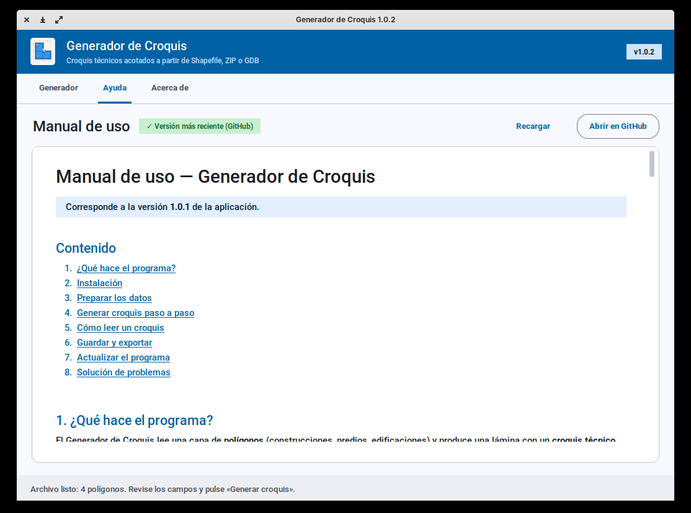
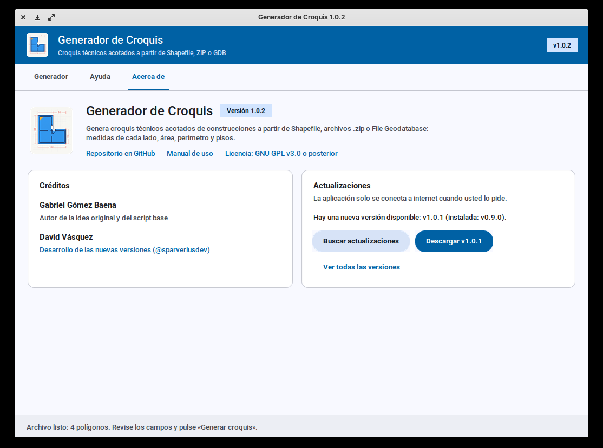
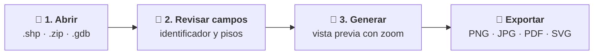
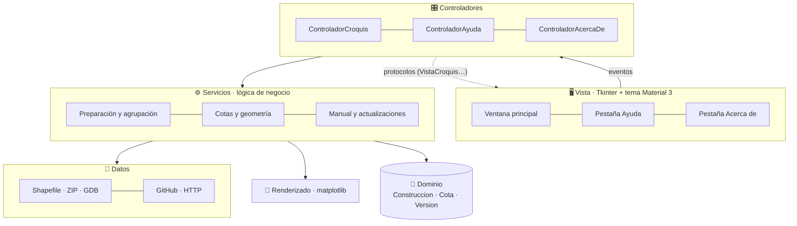
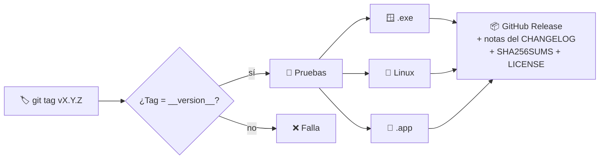

<!--
==============================================================================
Archivo  : README.md
Proyecto : Generador de Croquis
------------------------------------------------------------------------------
CHANGELOG (versión interna del documento)
  v2.2.1 | 2026-11-05 | 1.2.1: vista desde arriba, cotas con color del piso y
         |            | enlace a la hoja de ruta (ROADMAP.md).
  v2.2.0 | 2026-11-05 | Características de la 1.2.0: convenciones por piso y
         |            | unidades superpuestas visibles.
  v2.1.0 | 2026-11-05 | Características de la 1.1.0: acotado por vértices
         |            | principales, color por unidad y cotas sin solapes.
  v2.0.0 | 2026-11-05 | Rediseño visual siguiendo el estilo del perfil del
         |            | autor: cabecera centrada con logo y badges, botones de
         |            | descarga por sistema, galería de capturas, diagramas
         |            | Mermaid de arquitectura y de release, tech stack con
         |            | badges y secciones técnicas plegables. Documenta la
         |            | interfaz Material, la pestaña Ayuda y el logo (1.0.2).
  v1.2.1 | 2026-11-05 | Título «Versionado» (cambio del autor).
  v1.2.0 | 2026-11-05 | Enlaces al manual de uso, CONTRIBUTING y licencia GPL-3.0.
  v1.1.0 | 2026-11-05 | Documenta la pestaña "Acerca de" y las actualizaciones.
  v1.0.0 | 2026-11-05 | Creación. Descripción, instalación, uso, arquitectura,
         |            | desarrollo con uv, versionado SemVer, convención de
         |            | cabeceras, proceso de release multiplataforma y créditos.
==============================================================================
-->
<div align="center">



# Generador de Croquis

### 📐 Croquis técnicos acotados de construcciones, en un clic

Convierte capas de polígonos de **Shapefile**, **ZIP** o **File Geodatabase** en láminas
con la medida de cada lado, el área, el perímetro y el número de pisos.

[](https://github.com/sparveriusdev/GeneradorCroquis/releases/latest)
[](https://github.com/sparveriusdev/GeneradorCroquis/actions/workflows/ci.yml)
[](https://github.com/sparveriusdev/GeneradorCroquis/releases)
[](LICENSE)
[](pyproject.toml)
[](#-descarga)

<br/>

[](https://github.com/sparveriusdev/GeneradorCroquis/releases/latest)
[](https://github.com/sparveriusdev/GeneradorCroquis/releases/latest)
[](https://github.com/sparveriusdev/GeneradorCroquis/releases/latest)

[📘 Manual de uso](docs/MANUAL_DE_USO.md) ·
[📝 Novedades](CHANGELOG.md) ·
[🗺️ Hoja de ruta](ROADMAP.md) ·
[🐛 Reportar un problema](https://github.com/sparveriusdev/GeneradorCroquis/issues) ·
[🤝 Contribuir](CONTRIBUTING.md)

<br/>



</div>

---

## ✨ Características

| | |
|---|---|
| 📂 **Múltiples formatos** | `.shp`, `.zip` (con shapefiles o `.gdb` en cualquier subcarpeta) y carpetas File Geodatabase. Si hay varias capas, el programa pregunta cuál usar. |
| 🧠 **Detección automática** | Reconoce los campos de identificador (`codigo`, `npn`, `predio`, `objectid`…) y de pisos (`pisos`, `niveles`, `floors`…). |
| 🧱 **Agrupación inteligente** | Los polígonos con el mismo identificador forman una sola construcción, con todas sus partes. |
| 📏 **Acotado inteligente** | Solo se acotan los **vértices principales**: los de ajuste se agrupan y el lado mide la suma de sus tramos (tolerancia ajustable). |
| 🎨 **Un piso, un color** | Cada piso tiene siempre su color, y sus cotas también; un lado común se acota una vez, con el color del piso más alto. |
| 🗂️ **Convenciones por piso** | Leyenda con el color, el estilo de línea y el área de cada piso. Vista desde arriba: cada zona con el color del piso más alto, y contornos punteados para los pisos superiores. |
| 🧲 **Cotas sin solapes** | Cada etiqueta busca un hueco libre y, si se aleja, se une a su lado con una línea guía. |
| 🌐 **Medidas en metros** | Las capas en grados se reproyectan solas a **EPSG:9377** (MAGNA-SIRGAS Origen Nacional). |
| 🕳️ **Patios y multipolígonos** | Los huecos interiores se dibujan con línea punteada. |
| 🖼️ **Exportación profesional** | PNG, JPG, PDF o SVG a 300 dpi, listos para informes y anexos técnicos. |
| 🎨 **Interfaz Material Design** | Tipografía Roboto, tarjetas, pasos numerados y barra de estado que indica qué hacer después. |
| 📘 **Ayuda integrada** | El manual de uso dentro de la app, actualizado desde GitHub y disponible sin conexión. |
| 🔄 **Actualizaciones** | Comprueba y descarga la nueva versión para su sistema desde la propia aplicación. |
| 💻 **Multiplataforma** | Ejecutables para Windows, macOS y Linux. No requiere instalar Python. |

## 🖼️ Capturas

<div align="center">

| Croquis generado | Ayuda integrada | Acerca de y actualizaciones |
|:---:|:---:|:---:|
|  |  |  |

</div>

## 📥 Descarga

Descargue el archivo de su sistema desde **[la última versión](https://github.com/sparveriusdev/GeneradorCroquis/releases/latest)**:

| Sistema | Archivo | Cómo abrirlo |
|---|---|---|
| 🪟 **Windows 10/11** (64 bits) | `GeneradorCroquis-X.Y.Z-windows-x64.exe` | Doble clic. Si SmartScreen avisa: *Más información → Ejecutar de todas formas*. |
| 🍎 **macOS** (Apple Silicon) | `GeneradorCroquis-X.Y.Z-macos-arm64.zip` | Descomprimir y, la primera vez, *clic derecho → Abrir*. |
| 🐧 **Linux** (x64) | `GeneradorCroquis-X.Y.Z-linux-x64.tar.gz` | `tar xzf …` y luego `./GeneradorCroquis` |

> [!NOTE]
> Los ejecutables no están firmados digitalmente, por eso Windows y macOS muestran una advertencia
> la primera vez. Puede verificar cada descarga con `SHA256SUMS.txt`.

## 🚀 Uso en 3 pasos



1. **Abrir archivo…** o **Abrir carpeta GDB…**
2. Revise el *identificador de la construcción* y el *número de pisos* (se detectan solos).
3. **Generar croquis** y luego **Exportar imagen…**

También desde la terminal: `GeneradorCroquis ruta/datos.zip` · `GeneradorCroquis --version`

📘 La guía completa, con preparación de datos y solución de problemas, está en el
**[Manual de uso](docs/MANUAL_DE_USO.md)** y en la pestaña **Ayuda** de la aplicación.

## 🛠️ Tecnologías

<div align="center">


</div>

## 🏗️ Arquitectura

Patrón **Modelo-Vista-Controlador** por capas, con dependencias que apuntan hacia el dominio y
se inyectan en `app.py`:



<details>
<summary><b>📁 Estructura del código</b></summary>

```
src/generador_croquis/
├── app.py                  # Raíz de composición: crea e inyecta dependencias
├── config.py               # Constantes y parámetros (tema del croquis, EPSG, URLs, créditos)
├── assets/                 # Logo, icono y fuentes Roboto (OFL)
├── domain/                 # MODELO: entidades inmutables, Version (SemVer) y excepciones
├── data/                   # Fuentes de datos (Strategy por formato) y transporte HTTP
├── services/               # Lógica de negocio: cotas, campos, agrupación, Markdown, ayuda, actualizaciones
├── rendering/              # Dibujo de croquis con matplotlib (sin pyplot)
├── controller/             # CONTROLADORES + protocolos de vista y del ejecutor de tareas
└── view/                   # VISTA Tkinter: tema Material, componentes, pestañas y visor Markdown
```

</details>

<details>
<summary><b>🧭 Principios SOLID y DRY aplicados</b></summary>

| Principio | Dónde |
|---|---|
| Responsabilidad única | Leer, preparar, agrupar, dibujar y mostrar viven en módulos distintos. |
| Abierto/cerrado | Un formato nuevo es otra clase `FuenteDatos` registrada en `LectorCapas`. |
| Sustitución de Liskov | Cualquier `Renderizador` o vista que cumpla el protocolo sirve; las pruebas usan vistas falsas. |
| Segregación de interfaces | Protocolos pequeños: `Selector`, `FuenteDatos`, `TransporteHttp`, `VistaCroquis`, `VistaAyuda`… |
| Inversión de dependencias | Los controladores dependen de protocolos, no de Tkinter; todo se inyecta en `app.py`. |
| DRY | Un solo algoritmo de detección de campos, manejo de errores centralizado y todos los colores y fuentes en un único tema. |

</details>

## 🧑‍💻 Desarrollo

Requisitos: [**uv**](https://docs.astral.sh/uv/) y Python 3.11 – 3.13 con tkinter.

```bash
git clone https://github.com/sparveriusdev/GeneradorCroquis.git
cd GeneradorCroquis
uv sync                      # entorno + dependencias + herramientas de desarrollo
uv run generador-croquis     # ejecuta la aplicación
uv run pytest                # pruebas
uv run ruff check . && uv run ruff format .
```

<details>
<summary><b>📦 Construir el ejecutable localmente</b></summary>

```bash
uv run pyinstaller packaging/generador_croquis.spec --noconfirm
# dist/: GeneradorCroquis.exe (Windows) · GeneradorCroquis (Linux) · GeneradorCroquis.app (macOS)
```

> [!IMPORTANT]
> El Python que descarga uv trae **Tcl/Tk 9**. PyInstaller todavía no lo empaqueta bien, y en
> Linux ese Tk no usa las fuentes del sistema (Xft), así que la interfaz se ve con tipografía
> básica. Para construir el ejecutable, o para revisar el diseño en Linux, use un Python de
> python.org o del sistema: `uv sync --python /usr/bin/python3.12`. El CI ya lo hace así.

Para regenerar los iconos tras cambiar `assets/logo.jpeg`:
`uv run python packaging/generar_iconos.py`

</details>

<details>
<summary><b>🔖 Versionado y publicación</b></summary>

La versión sigue [SemVer](https://semver.org/lang/es/) y vive en un solo lugar:
`src/generador_croquis/__init__.py`. Cada versión se documenta en [`CHANGELOG.md`](CHANGELOG.md).



```bash
git commit -am "chore(release): vX.Y.Z"
git tag -a vX.Y.Z -m "vX.Y.Z"
git push origin main --tags
```

</details>

<details>
<summary><b>📝 Convención de cabeceras con changelog</b></summary>

Cada archivo nuevo o modificado lleva en su cabecera un changelog interno, con la entrada más
reciente arriba:

```python
# ==============================================================================
# Archivo  : src/generador_croquis/ejemplo.py
# Proyecto : Generador de Croquis
# ------------------------------------------------------------------------------
# CHANGELOG (versión interna del documento)
#   v1.1.0 | 2026-12-01 | Descripción del cambio más reciente.
#   v1.0.0 | 2026-11-05 | Creación.
# ==============================================================================
```

En Markdown se usa el mismo bloque dentro de `<!-- … -->`. Más detalles en
[CONTRIBUTING.md](CONTRIBUTING.md).

</details>

## 👥 Créditos

<table>
  <tr>
    <td align="center" width="50%">
      <b>Gabriel Gómez Baena</b><br/>
      <sub>💡 Idea original y script base</sub>
    </td>
    <td align="center" width="50%">
      <a href="https://github.com/sparveriusdev"></a><br/>
      <b>David Vásquez</b> · <a href="https://github.com/sparveriusdev">@sparveriusdev</a><br/>
      <sub>🏗️ Arquitectura y desarrollo de las nuevas versiones</sub>
    </td>
  </tr>
</table>

Tipografía [Roboto](https://github.com/googlefonts/roboto-3-classic) © The Roboto Project
Authors, bajo licencia SIL Open Font License 1.1.

## 📄 Licencia

Copyright © 2026 Gabriel Gómez Baena y David Vásquez.

Este programa es software libre: puede redistribuirlo y/o modificarlo bajo los términos de la
**Licencia Pública General GNU** publicada por la Free Software Foundation, ya sea la versión 3
de la licencia o (a su elección) cualquier versión posterior. Se distribuye con la esperanza de
que sea útil, pero **SIN NINGUNA GARANTÍA**. Consulte el archivo [LICENSE](LICENSE).

---

<div align="center">

### 📐 "Cada construcción tiene sus medidas; cada medida, su croquis"

Hecho en Colombia 🇨🇴 · ¿Le sirvió? Deje una ⭐ en el repositorio

</div>
