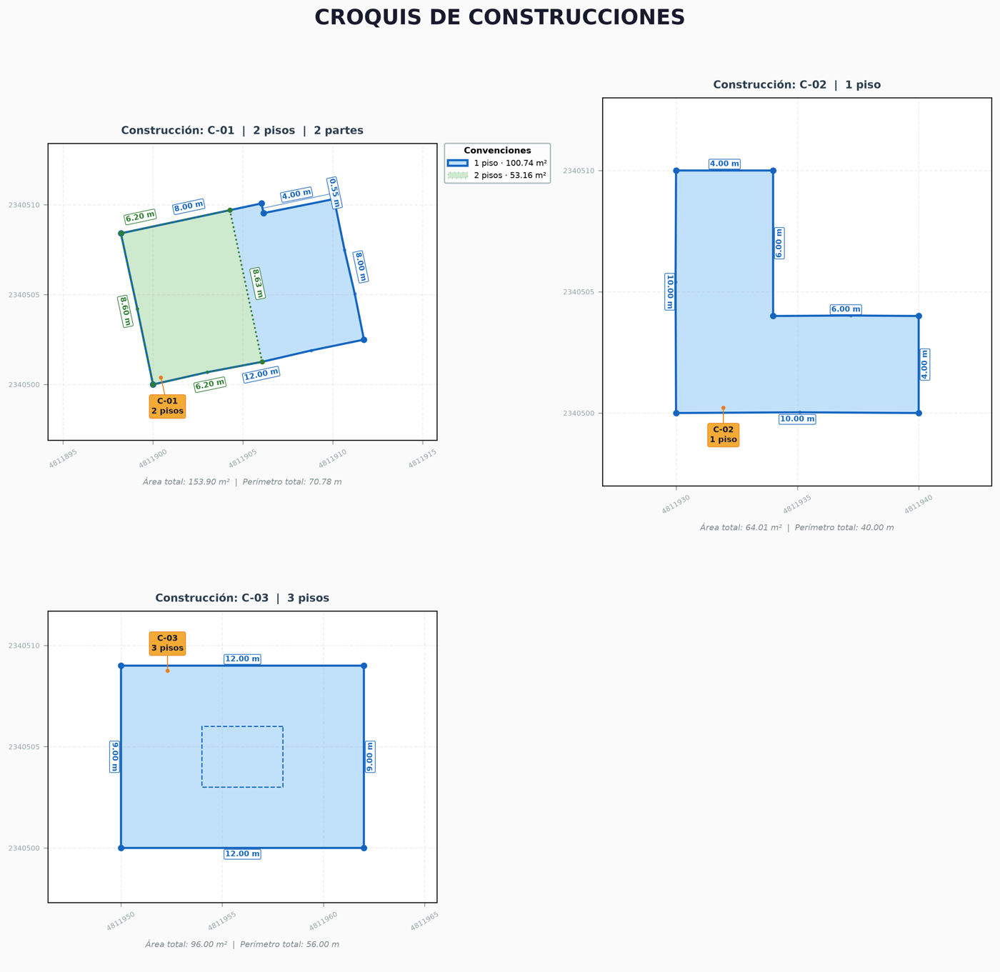
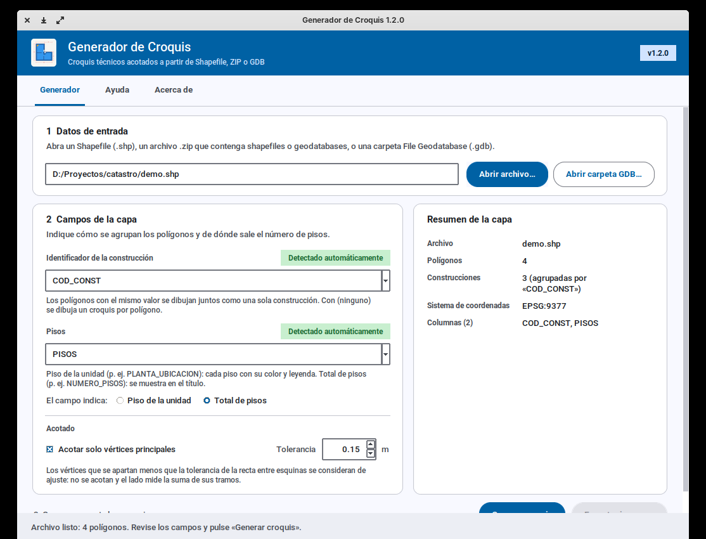
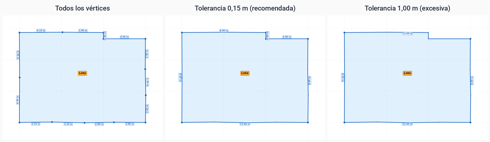
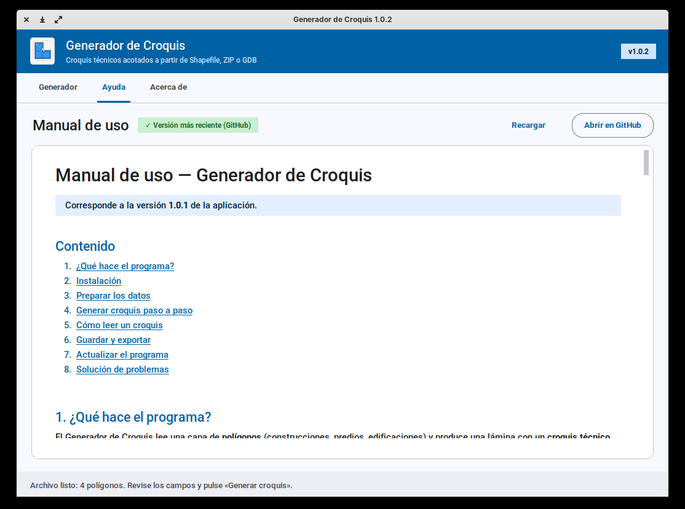
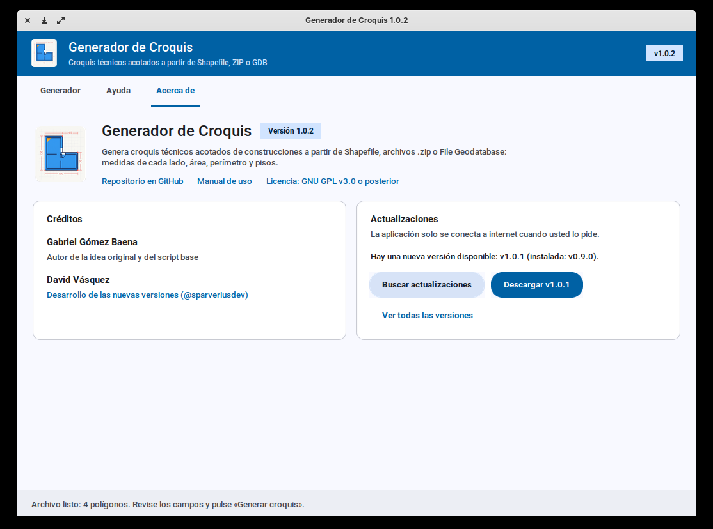

<!--
==============================================================================
Archivo  : docs/MANUAL_DE_USO.md
Proyecto : Generador de Croquis
------------------------------------------------------------------------------
CHANGELOG (versión interna del documento)
  v1.7.0 | 2026-11-06 | Versión 1.3.0: etiqueta del identificador fuera de
         |            | la construcción con línea guía y arrastrable en la
         |            | vista previa; ejemplo actualizado.
  v1.6.0 | 2026-11-05 | Versión 1.2.1: vista desde arriba (cada zona con el
         |            | color del piso más alto), contornos superiores
         |            | punteados y cota común con el color del piso más alto.
  v1.5.0 | 2026-11-05 | Opción «El campo indica» (piso de la unidad / total
         |            | de pisos) y etiqueta pequeña del identificador.
  v1.4.0 | 2026-11-05 | Versión 1.2.0: convenciones por piso, unidades
         |            | superpuestas discontinuas, cota común gris, ejes
         |            | con decimales automáticos.
  v1.3.0 | 2026-11-05 | Nueva subsección «Vértices principales y tolerancia»:
         |            | qué son, cómo elegir la tolerancia (valores
         |            | orientativos), riesgos y comparación visual.
  v1.2.0 | 2026-11-05 | Versión 1.1.0: acotado por vértices principales,
         |            | cotas del color de su unidad, sin solapes; nueva
         |            | opción «Acotado» y ejemplo actualizado.
  v1.1.0 | 2026-11-05 | Actualizado a la interfaz 1.0.2 (Material Design):
         |            | nuevos nombres de botones, tarjetas, resumen,
         |            | barra de estado, pestaña Ayuda y capturas nuevas.
  v1.0.0 | 2026-11-05 | Creación. Manual de usuario para la versión 1.0.1 de
         |            | la aplicación: instalación, preparación de datos,
         |            | generación y exportación de croquis, actualizaciones
         |            | y solución de problemas.
==============================================================================
-->
# Manual de uso — Generador de Croquis

> Corresponde a la versión **1.2.1** de la aplicación.

## Contenido

1. [¿Qué hace el programa?](#1-qué-hace-el-programa)
2. [Instalación](#2-instalación)
3. [Preparar los datos](#3-preparar-los-datos)
4. [Generar croquis paso a paso](#4-generar-croquis-paso-a-paso)
5. [Cómo leer un croquis](#5-cómo-leer-un-croquis)
6. [Guardar y exportar](#6-guardar-y-exportar)
7. [Actualizar el programa](#7-actualizar-el-programa)
8. [Solución de problemas](#8-solución-de-problemas)

---

## 1. ¿Qué hace el programa?

El Generador de Croquis lee una capa de **polígonos** (construcciones, predios, edificaciones)
y produce una lámina con un **croquis técnico por construcción**. Cada croquis muestra:

- La planta de la construcción, con cada parte (unidad) en un color distinto.
- La **medida de cada lado** en metros, entre los **vértices principales**, con la cota del
  mismo color que su unidad y sin que las etiquetas se monten unas sobre otras.
- Los **huecos interiores** (patios, vacíos) con línea punteada.
- Una etiqueta con el **identificador** y el **número de pisos**, fuera de la construcción y
  unida a ella con una línea guía.
- El **área total** y el **perímetro total** al pie del croquis.



## 2. Instalación

No hace falta instalar Python ni ninguna librería. Descargue el archivo de su sistema desde la
página de **Releases** del repositorio:
<https://github.com/sparveriusdev/GeneradorCroquis/releases>

### Windows 10/11

1. Descargue `GeneradorCroquis-X.Y.Z-windows-x64.exe`.
2. Haga doble clic. Si aparece **"Windows protegió su PC"** (SmartScreen), pulse
   **Más información → Ejecutar de todas formas**. El aviso sale porque el ejecutable no tiene
   firma digital comercial.
3. Opcional: mueva el `.exe` a una carpeta fija (por ejemplo `C:\Programas\GeneradorCroquis`) y
   cree un acceso directo en el escritorio.

> La primera vez tarda unos segundos más en abrir: el ejecutable se descomprime en una
> carpeta temporal.

### macOS (Apple Silicon: M1, M2, M3…)

1. Descargue `GeneradorCroquis-X.Y.Z-macos-arm64.zip` y descomprímalo.
2. Arrastre `GeneradorCroquis.app` a **Aplicaciones**.
3. La primera vez: **clic derecho → Abrir → Abrir**. Si macOS no lo permite, vaya a
   **Ajustes del Sistema → Privacidad y seguridad** y pulse **Abrir igualmente**.

### Linux (x64)

```bash
tar xzf GeneradorCroquis-X.Y.Z-linux-x64.tar.gz
./GeneradorCroquis
```

### Verificar la descarga (opcional)

Cada release incluye `SHA256SUMS.txt` con la huella de cada archivo:

- Windows (PowerShell): `Get-FileHash .\GeneradorCroquis-X.Y.Z-windows-x64.exe`
- macOS / Linux: `shasum -a 256 GeneradorCroquis-X.Y.Z-*`

El valor debe coincidir con el que aparece en `SHA256SUMS.txt`.

## 3. Preparar los datos

### Formatos aceptados

| Formato | Cómo abrirlo | Notas |
|---|---|---|
| Shapefile (`.shp`) | **Abrir archivo…** | Deben estar en la misma carpeta, como mínimo, `.shp`, `.shx` y `.dbf`; conviene incluir también `.prj`. |
| Archivo `.zip` | **Abrir archivo…** | Puede contener shapefiles y/o carpetas `.gdb`, en cualquier subcarpeta. Si hay varios, el programa pregunta cuál usar. |
| File Geodatabase (`.gdb`) | **Abrir carpeta GDB…** | Seleccione la **carpeta** `.gdb`. Si tiene varias capas, el programa pregunta cuál usar. |

### Requisitos de la capa

- **Geometría de polígonos** (Polygon o MultiPolygon). Puntos y líneas se ignoran; si la capa no
  tiene polígonos, el programa lo avisa.
- **Sistema de coordenadas (CRS)**:
  - Si la capa está en un sistema **proyectado en metros** (por ejemplo MAGNA-SIRGAS /
    Origen Nacional, EPSG:9377), las medidas se usan tal cual.
  - Si está en **coordenadas geográficas** (grados, por ejemplo WGS84 / EPSG:4326), el programa
    la **reproyecta automáticamente a EPSG:9377** para obtener metros, y lo indica con un aviso
    en *Resumen de la capa*.
  - Si la capa **no tiene CRS** (falta el `.prj`), las medidas salen en las unidades originales
    del archivo y se muestra un aviso.

### Campos recomendados

| Campo | Para qué sirve | Nombres que se detectan solos |
|---|---|---|
| **Identificador** | Agrupa los polígonos que forman una misma construcción. | `id`, `cod`, `codigo`, `code`, `id_construccion`, `predio`, `lote`, `ficha`, `npn`, `matricula`, `objectid`… |
| **Pisos** | Número de pisos que se muestra en el croquis. | `pisos`, `piso`, `niveles`, `floors`, `num_pisos`, `nro_pisos`, `plantas`… |

Los nombres se reconocen sin distinguir mayúsculas y también como parte de un nombre más largo
(por ejemplo `COD_CONST` o `NUM_PISOS`). Si no se detectan, se eligen a mano en la lista.

> **Varias partes, una construcción:** si una construcción está dibujada en varios polígonos
> (por ejemplo, cuerpo principal y anexo), todos deben tener el **mismo valor** en el campo
> identificador. Si los pisos difieren entre partes, se muestra el valor **más alto**.

## 4. Generar croquis paso a paso

La ventana tiene tres pestañas: **Generador**, **Ayuda** (este manual) y **Acerca de**. En la
pestaña **Generador** el trabajo se hace en tres pasos, de arriba abajo, y la **barra de estado**
inferior indica siempre qué hacer a continuación.



1. **Datos de entrada.** Pulse **Abrir archivo…** (`.zip` / `.shp`) o **Abrir carpeta GDB…**
   (carpeta `.gdb`). Si el archivo tiene varias capas o conjuntos de datos, elija uno en la
   lista (doble clic o **Enter** para aceptar, **Escape** para cancelar).
2. **Campos de la capa.** El programa propone los campos y lo indica con la marca verde
   **Detectado automáticamente**. Cámbielos si no son los correctos:
   - *Identificador de la construcción*: los polígonos con el mismo valor se dibujan juntos.
     Con `(ninguno)` se dibuja un croquis por cada polígono.
   - *Pisos*: opcional; con `(ninguno)` los croquis no muestran pisos. Debajo, **El campo
     indica** dice qué significa ese campo. Se elige solo por el nombre, y puede cambiarse:

     | Opción | Ejemplo de campo | Resultado |
     |---|---|---|
     | **Piso de la unidad** | `PLANTA_UBICACION`, `nivel`, `piso` | Cada unidad con el color de su piso (piso 1 azul, piso 2 verde…), leyenda de convenciones **aunque el croquis tenga una sola unidad** y título «Piso 2» o «Pisos 1, 2». |
     | **Total de pisos** | `NUMERO_PISOS`, `pisos`, `niveles` | El total se muestra en el título («3 pisos»); los colores siguen el orden de las unidades. |

     En capas LADM-COL de unidades de construcción, use `PLANTA_UBICACION` con **Piso de la
     unidad**. Para ver juntas todas las unidades de una construcción, agrupe por un código
     que compartan (p. ej. `CODIGO_UNIDAD_CONSTRUCCION`); si agrupa por `IDENTIFICADOR`, cada
     unidad sale en su propio croquis, con su piso y su leyenda.
   - *Acotado*: con **Acotar solo vértices principales** activado (recomendado), los vértices
     de ajuste que se apartan menos que la **tolerancia** (0,15 m por defecto) de la recta
     entre esquinas no se acotan: el lado se mide de esquina a esquina, sumando sus tramos.
     Suba la tolerancia si aún aparecen cotas de tramos muy cortos; bájela o desactive la
     casilla para acotar vértice a vértice. Acepta coma o punto decimal (`0,15` o `0.15`).
     Vea [Vértices principales y tolerancia](#vértices-principales-y-tolerancia).

   La tarjeta **Resumen de la capa** muestra el archivo, el número de polígonos y de
   construcciones, el sistema de coordenadas y las columnas, junto con los avisos (por ejemplo,
   si la capa se reproyectó o no tiene sistema de coordenadas).
3. **Generar y exportar.** Pulse **Generar croquis**. Se abre una ventana con la lámina
   completa.
   - Si hay más de **30 construcciones**, el programa pide confirmación porque la imagen puede
     tardar y consumir mucha memoria. Para lotes grandes conviene filtrar la capa antes en un
     SIG (QGIS / ArcGIS).
4. **Explorar la vista previa** con la barra inferior de esa ventana:
   - 🔍 **Zoom**: dibuje un rectángulo sobre la zona a ampliar.
   - ✥ **Mover**: arrastre para desplazarse.
   - 🏠 **Inicio**: vuelve a la vista completa.
   - 🏷️ **Mover la etiqueta naranja**: con **Zoom** y **Mover** desactivados, arrástrela con
     el ratón a donde se lea mejor. La línea guía la sigue y sigue apuntando a su
     construcción. **Exportar imagen…** guarda la etiqueta en la nueva posición; si vuelve a
     pulsar **Generar croquis**, las etiquetas regresan a su posición automática.

También puede abrir un archivo directamente desde la terminal:
`GeneradorCroquis ruta/al/archivo.zip`.

### Vértices principales y tolerancia

En catastro, un polígono suele tener más vértices que esquinas: al ajustar la construcción o
el terreno a la cartografía aparecen **vértices de ajuste** casi alineados con el lado. Si se
acotan todos, el croquis se llena de medidas cortas que no corresponden a lados reales.

Con **Acotar solo vértices principales** activado, el programa conserva solo las **esquinas
reales** (puntos grandes) y une los tramos intermedios en un único lado, cuya medida es la
**suma de sus tramos**. Los vértices de ajuste se siguen dibujando como puntos pequeños: la
geometría, el área y el perímetro **no cambian**, solo qué lados se acotan.



**¿Qué es la tolerancia?** Es la distancia máxima, en metros, que un vértice puede apartarse de
la recta entre las esquinas vecinas para considerarse de ajuste. Si se aparta más, es una
esquina real y se acota.

**Valores orientativos**

| Tolerancia | Cuándo usarla |
|---|---|
| **0,05 m** | Levantamientos precisos (estación total, GNSS) en los que casi todos los vértices son esquinas reales. |
| **0,15 m** *(por defecto)* | Catastro general: elimina los vértices de ajuste habituales y conserva quiebres desde unos 20 cm. |
| **0,30 – 0,50 m** | Digitalizaciones irregulares (sobre ortofoto o planos escaneados) con bordes ondulados. |

**Cómo ajustarla**

1. Empiece con **0,15 m** y pulse **Generar croquis**.
2. Si todavía aparecen cotas de **tramos muy cortos** que no son esquinas, súbala de
   **0,05 en 0,05 m** y genere de nuevo.
3. Si **desapareció un lado real corto** (un entrante, un retroceso de fachada), bájela por
   debajo de la longitud de ese lado.
4. Para acotar **vértice a vértice**, como en versiones anteriores, desactive la casilla.

> [!WARNING]
> Una tolerancia demasiado alta **absorbe esquinas reales**. En el ejemplo, con 1,00 m el
> quiebre de 0,60 m desaparece y el lado superior pasa a medir 12,60 m (8,00 + 0,60 + 4,00).
> Regla práctica: la tolerancia debe ser **menor que el lado real más corto** que quiera
> conservar.

### La pestaña Ayuda

Muestra este mismo manual con formato. Al abrirla, el programa descarga de GitHub la versión
más reciente (marca verde **Versión más reciente (GitHub)**); si no hay internet, muestra la
copia incluida en el programa (**Copia incluida · sin conexión**). Los enlaces del índice
llevan a cada sección; **Recargar** vuelve a consultar y **Abrir en GitHub** lo abre en el
navegador.



## 5. Cómo leer un croquis

| Elemento | Significado |
|---|---|
| Título `Construcción: X  \|  3 pisos  \|  M partes` | Identificador, pisos («3 pisos» si el campo es el total; «Piso 2» o «Pisos 1, 2» si es el piso de cada unidad) y número de polígonos que la forman. |
| Etiqueta naranja con línea guía | Identificador y pisos. Se coloca **fuera** de la construcción, en un hueco libre de cotas, y la línea termina en un punto (•) dentro de la construcción. Si no hay espacio afuera, queda adentro. Los códigos largos se parten en varias líneas; el código completo está en el título. Puede moverla en la vista previa. |
| Cotas (`10.00 m`) | Longitud de cada lado del contorno exterior entre vértices principales, en metros, con dos decimales. Si el lado tiene vértices de ajuste, es la **suma de sus tramos**. |
| Color de la cota | El mismo de la unidad a la que pertenece el lado. Cada piso tiene siempre el mismo color: piso 1 azul, piso 2 verde, piso 3 rojo, piso 4 morado… |
| Cota de un lado común | Si varias unidades comparten un lado con la misma medida, se acota una sola vez, con el color del **piso más alto** que tiene ese lado (el mismo color de la zona que se ve junto a la cota). |
| Línea fina hacia una cota | La cota se apartó de su lado para no tocar otra etiqueta; la línea la une con su lado. |
| Línea punteada | Hueco interior (patio o vacío). Sus lados no se acotan. |
| Puntos grandes | Vértices principales (esquinas reales). |
| Puntos pequeños | Vértices de ajuste: forman parte del polígono, pero no se acotan. |
| Recuadro «Convenciones» | Color y estilo de línea de cada piso, con su área. Aparece cuando la construcción tiene 2 o más unidades, o siempre si el campo de pisos indica el **piso de la unidad**. |
| Color de relleno de cada zona | Vista desde arriba: cada zona se pinta con el color (en tono claro) del **piso más alto** que la cubre. Así se ve de un vistazo qué parte tiene 2, 3 o 4 pisos. |
| Línea continua gruesa | Contorno del piso más bajo (o de una unidad que no está encima de otra). |
| Línea punteada | Contorno de una unidad que está **encima** de otra de un piso inferior. Deja ver los límites de cada piso aunque su zona quede cubierta por un piso más alto. |
| Pie del croquis | Área total (m²) y perímetro total (m), sumando todas las partes. |
| Ejes | Coordenadas completas del sistema de referencia de la capa, en metros (útiles para ubicar la construcción). Solo se muestran los decimales necesarios: normalmente ninguno. |

> En construcciones con varias partes (por ejemplo, unidades superpuestas de distintos pisos),
> el **área** y el **perímetro** son la suma de los de cada parte; el área de cada piso aparece
> en las convenciones.

## 6. Guardar y exportar

1. Después de generar, pulse **Exportar imagen…**.
2. Elija el nombre y el formato:

| Formato | Recomendado para |
|---|---|
| **PNG** | Uso general, documentos e informes (300 dpi). |
| **JPEG** | Archivos más livianos para correo. |
| **PDF** | Impresión y anexos técnicos; el texto se mantiene nítido a cualquier zoom. |
| **SVG** | Edición posterior en Inkscape, Illustrator o CAD. |

La imagen se exporta **siempre con su tamaño original**, aunque haya cambiado el tamaño de la
ventana de vista previa.

## 7. Actualizar el programa



1. Abra la pestaña **Acerca de**. Ahí se ve la **versión instalada**, los créditos, la licencia
   y los enlaces al repositorio y a este manual.
2. Pulse **Buscar actualizaciones**. El programa consulta GitHub (necesita internet; es la
   única función que se conecta a la red).
3. Si hay una versión nueva, el botón cambia a **Descargar vX.Y.Z**. Púlselo y elija la carpeta
   donde guardarla; la barra muestra el avance.
4. Al terminar, **cierre el programa** y abra el archivo descargado. En Windows puede borrar el
   `.exe` anterior.

**Ver todas las versiones** abre en el navegador la página del release con las novedades de
cada versión.

## 8. Solución de problemas

| Problema | Causa probable | Solución |
|---|---|---|
| *"Shapefile incompleto: … (falta .dbf)"* | Faltan archivos compañeros del `.shp`. | Copie juntos `.shp`, `.shx`, `.dbf` y `.prj`, o comprímalos en un `.zip`. |
| *"No se encontró ningún .shp ni .gdb válido dentro del .zip"* | El `.zip` no tiene datos espaciales o están incompletos. | Revise el contenido del `.zip`. |
| *"La capa no contiene polígonos"* | Se eligió una capa de puntos o líneas. | Elija la capa de construcciones / polígonos. |
| *"No se pudo leer el GDB"* | Se seleccionó una carpeta que no es `.gdb` o la geodatabase está dañada. | Con **Abrir carpeta GDB…**, seleccione la carpeta que termina en `.gdb`. |
| Las medidas no parecen metros | La capa no tiene CRS (falta `.prj`). | Asigne el sistema de coordenadas en QGIS/ArcGIS y vuelva a exportar. |
| Hay un croquis por polígono en lugar de por construcción | El campo identificador está en `(ninguno)` o no es el correcto. | Elija el campo que identifica cada construcción. |
| *"No se pudo conectar con GitHub"* | Sin internet, proxy o firewall. | Revise la conexión o descargue manualmente desde la página de Releases. |
| *"GitHub limitó temporalmente las consultas"* | Demasiadas consultas desde la misma red en una hora. | Intente de nuevo más tarde. |
| Windows / macOS bloquea el programa al abrirlo | El ejecutable no está firmado. | Vea [Instalación](#2-instalación). |

### Archivo de registro

Los errores se guardan con detalle técnico en:

- **Windows:** `C:\Users\<usuario>\.generador_croquis\croquis.log`
- **macOS / Linux:** `~/.generador_croquis/croquis.log`

Al reportar un problema, adjunte ese archivo y, si es posible, un `.zip` con datos de ejemplo
en un *issue* del repositorio:
<https://github.com/sparveriusdev/GeneradorCroquis/issues>
